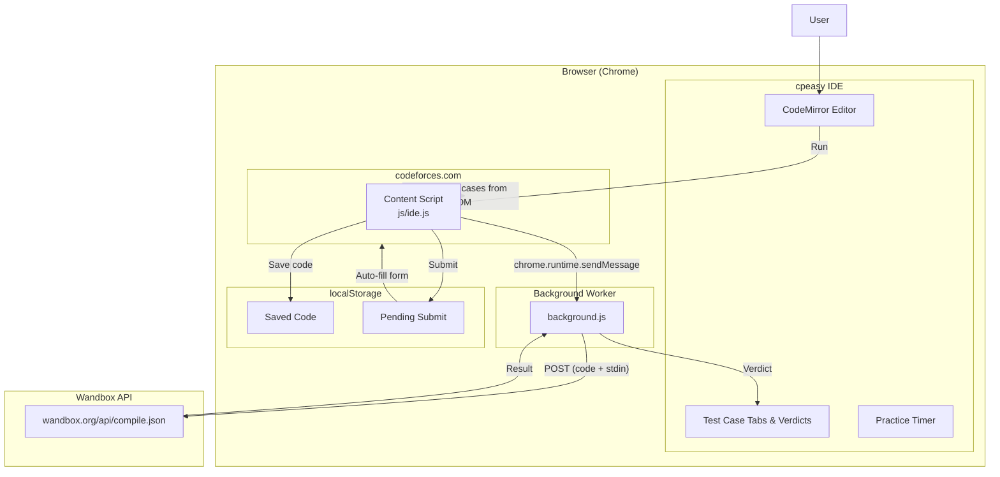

<div align="center">

<!-- Logo & Title -->


# **cpeasy**

### LeetCode-style IDE for Codeforces — right inside your browser.

Run sample test cases instantly. No tab-switching. No copy-pasting. Just code and submit.

[](https://developer.chrome.com/docs/extensions/)
[](https://developer.chrome.com/docs/extensions/develop/migrate/what-is-mv3)
[](LICENSE)
[](https://codeforces.com)

<br />

**cpeasy** transforms any Codeforces problem page into a split-screen coding environment — a full editor on the right, the problem statement on the left — with **one-click test case execution** against the free Wandbox compiler API. It's the experience Codeforces doesn't give you.

</div>

---

## The Problem

On Codeforces, writing and testing code is a **friction-heavy loop**:

> Open problem → copy sample input → switch to IDE → paste → run → switch back → compare output → fix → repeat → finally submit

Every competitive programmer knows this dance. It wastes seconds on every problem, and seconds compound across a contest.

## The Solution

**cpeasy** eliminates that loop entirely:

> Open problem → click **"Open cpeasy IDE"** → write code → click **Run** → see verdicts instantly → click **Submit**

One page. One flow. Zero context switches.

---

## Features

<table>
<tr>
<td width="50%" valign="top">

### Split-Screen Editor
A full **CodeMirror 5** editor (Material dark theme) injected as a resizable right panel alongside the problem statement. Supports syntax highlighting, auto-close brackets, line numbers, and tab/indent controls.

</td>
<td width="50%" valign="top">

### Run Against Sample Cases
cpeasy **scrapes the sample test cases** directly from the Codeforces page DOM — including smart detection of multi-test-case problems (the `t` pattern) — and runs your code against all of them in parallel.

</td>
</tr>
<tr>
<td width="50%" valign="top">

### Per-Case Verdicts
Each test case gets its own **tabbed result view** with a color-coded verdict: <span style="color:#4CAF50">Accepted</span>, <span style="color:#f44336">Wrong Answer</span>, <span style="color:#FF9800">Compilation Error</span>, or <span style="color:#9C27B0">Runtime Error</span>. Expand any tab to compare Input, Your Output, and Expected Output side by side.

</td>
<td width="50%" valign="top">

### Custom Test Cases
A **Custom** tab is always available — write your own input, run it, and see the output. Perfect for edge-case testing and debugging.

</td>
</tr>
<tr>
<td width="50%" valign="top">

### Practice Timer
A built-in **stopwatch** auto-starts when you open the IDE. Track how long you take per problem — essential for contest simulation and self-improvement.

</td>
<td width="50%" valign="top">

### One-Click Submit
Hit **Submit** and cpeasy saves your code, navigates to the Codeforces submit page, and **auto-fills the entire submission form** — language, problem code, and source code. Just confirm and go.

</td>
</tr>
<tr>
<td width="50%" valign="top">

### Code Persistence
Your code is **auto-saved per problem, per language** in `localStorage`. Come back to a problem tomorrow and your code is exactly where you left it.

</td>
<td width="50%" valign="top">

### 8 Languages Supported
Write in **C++, C, Java, Python, JavaScript, C#, Rust, or Go** — each with a smart competitive programming template that auto-includes the `t` test-case loop.

</td>
</tr>
</table>

---

## How It Works

```
┌──────────────────────────────────────────────────────────────────────┐
│                        CODEFORCES PAGE                              │
│                                                                     │
│  ┌─────────────────────────┐  ┌──────────────────────────────────┐  │
│  │                         │  │  🔧 cpeasy IDE                   │  │
│  │   Problem Statement     │  │                                  │  │
│  │   ─────────────────     │  │  [C++ ▼] [▶ 00:00] [Run] [Sub]  │  │
│  │   Input / Output /      │  │  ┌────────────────────────────┐  │  │
│  │   Constraints /         │  │  │  Code Editor               │  │  │
│  │   Sample Tests          │  │  │  (CodeMirror + Syntax HL)  │  │  │
│  │                         │  │  │                            │  │  │
│  │                         │  │  └────────────────────────────┘  │  │
│  │                         │  │  ┌────────────────────────────┐  │  │
│  │                         │  │  │  [TC1 ✅] [TC2 ❌] [Custom] │  │  │
│  │                         │  │  │  Verdict: Accepted         │  │  │
│  │                         │  │  │  Input:    5               │  │  │
│  │                         │  │  │  Output:   120             │  │  │
│  │                         │  │  │  Expected: 120             │  │  │
│  └─────────────────────────┘  └──────────────────────────────────┘  │
│                                                                     │
└──────────────────────────────────────────────────────────────────────┘
```

### Architecture



---

## Supported Languages

| Language | Compiler | Template |
|----------|----------|----------|
| **C++ 20** | `gcc-13.2.0` | Multi-T / Single-T / Blank |
| **C** | `gcc-13.2.0-c` | Multi-T / Single-T / Blank |
| **Java 22** | `openjdk-jdk-22+36` | Multi-T / Single-T / Blank |
| **Python 3.13** | `cpython-3.13.8` | Multi-T / Single-T / Blank |
| **Node.js 20** | `node-20.17.0` | Multi-T / Single-T / Blank |
| **C# (.NET 8)** | `dotnet-sdk-8.0.300` | Multi-T / Single-T / Blank |
| **Rust 1.82** | `rustc-1.82.0` | Multi-T / Single-T / Blank |
| **Go 1.23** | `go-1.23.3` | Multi-T / Single-T / Blank |

Each language includes a **competitive programming template** with the standard `t` test-case loop, `#include` headers, and boilerplate — so you can start typing your solution immediately.

---

## Installation

### Option 1: Load as Unpacked Extension (Development)

1. **Clone the repository**
   ```bash
   git clone https://github.com/your-username/cpeasy.git
   ```

2. **Open Chrome Extensions page**
   - Navigate to `chrome://extensions/`
   - Enable **Developer mode** (toggle in top-right)

3. **Load the extension**
   - Click **"Load unpacked"**
   - Select the `cpeasy` folder (the one containing `manifest.json`)

4. **Pin the extension**
   - Click the puzzle icon in Chrome's toolbar
   - Pin **cpeasy** for easy access

### Option 2: Install from Chrome Web Store

> _Coming soon. Stay tuned._

---

## Usage

1. **Navigate** to any Codeforces problem page (e.g., `codeforces.com/contest/1/problem/A`)
2. **Click** the **"Open cpeasy IDE"** button that appears next to the problem title
3. **Write** your solution in the editor that opens on the right
4. **Click Run** — cpeasy automatically scrapes sample test cases and executes your code against all of them in parallel
5. **Review** verdicts in the tabbed results panel — expand any tab to see Input / Output / Expected
6. **Click Submit** to auto-fill and submit your solution on Codeforces

---

## Smart Test Case Detection

cpeasy goes beyond basic input/output scraping. It understands Codeforces' DOM structure for **multi-test-case problems**:

```
Standard problem:
  Sample 1: Input A → Expected Output A    (run independently)
  Sample 2: Input B → Expected Output B    (run independently)

Multi-test-case problem (t cases):
  Sample 1: Input [t, case1, case2, ...] → Expected [out1, out2, ...]
  (batched into a single execution — split into per-case verdicts)
```

This means your code runs **exactly as it would on the judge** — the `t` loop receives all cases at once, and results are intelligently sliced back into per-case tabs.

---

## Project Structure

```
cpeasy/
├── manifest.json          # Chrome Extension Manifest V3
├── background.js          # Service worker — Wandbox API communication
├── popup.html             # Extension popup (branding & status)
├── icon.png               # Extension icon
│
├── js/
│   ├── ide.js             # Core IDE — UI injection, test case execution, verdicts
│   ├── config.js          # Language configs, compiler mappings, templates
│   ├── utils.js           # DOM scraping, text formatting, error handling
│   └── autofill.js        # Auto-fills Codeforces submit form
│
├── css/
│   └── styles.css         # Full dark-theme IDE styling (700+ lines)
│
├── lib/
│   ├── codemirror.min.js  # CodeMirror 5 core
│   ├── codemirror.min.css # CodeMirror base styles
│   ├── material.min.css   # Material dark theme
│   ├── clike.min.js       # C/C++/Java/C# language mode
│   ├── python.min.js      # Python language mode
│   ├── javascript.js      # JavaScript language mode
│   ├── rust.js            # Rust language mode
│   └── go.js              # Go language mode
│
└── README.md
```

---

## Tech Stack

| Component | Technology |
|-----------|-----------|
| Platform | Chrome Extension (Manifest V3) |
| Language | Vanilla JavaScript (ES6+, zero dependencies) |
| Code Editor | CodeMirror 5 (bundled, Material dark theme) |
| Styling | Pure CSS with CSS custom properties |
| Compilation | Wandbox API (`wandbox.org`) |
| Persistence | `localStorage` (per-problem, per-language) |
| Build System | **None** — no npm, no webpack, no build step |

> **Philosophy:** Zero build tools. Zero npm dependencies. Drop the folder into Chrome and it works.

---

## Key Design Decisions

- **No build step** — the extension loads raw source files directly. This makes it hackable and contributor-friendly.
- **Bundled CodeMirror** — no CDN dependency. Works offline, loads instantly, no external requests except the Wandbox API.
- **Wandbox over Judge0** — Wandbox is free, requires no API key, supports 8+ languages, and has reliable uptime.
- **localStorage over Chrome Storage** — simpler API, synchronous access, and sufficient for the use case.
- **Parallel execution with bounded pool** — up to 4 simultaneous Wandbox calls for fast test case runs without overwhelming the API.

---

## Contributing

Contributions are welcome! Here's how:

1. **Fork** the repository
2. **Create** a feature branch (`git checkout -b feature/amazing-feature`)
3. **Commit** your changes (`git commit -m 'Add amazing feature'`)
4. **Push** to the branch (`git push origin feature/amazing-feature`)
5. **Open** a Pull Request

### Ideas for Contributions

- [ ] Custom test case runner (beyond Codeforces samples)
- [ ] Local test case execution (Browser-based sandbox)
- [ ] Dark/Light theme toggle
- [ ] Keyboard shortcuts (Run: `Ctrl+Enter`, Submit: `Ctrl+Shift+Enter`)
- [ ] Support for other platforms (AtCoder, CodeChef, LeetCode)
- [ ] Code snippet library / templates
- [ ] Contest mode with integrated timer and score tracker

---

## License

This project is licensed under the **MIT License** — see the [LICENSE](LICENSE) file for details.

---

<div align="center">

**Built with care for the competitive programming community.**

_Star the repo if cpeasy saves you time. Fork it if you want to make it better._

</div>
