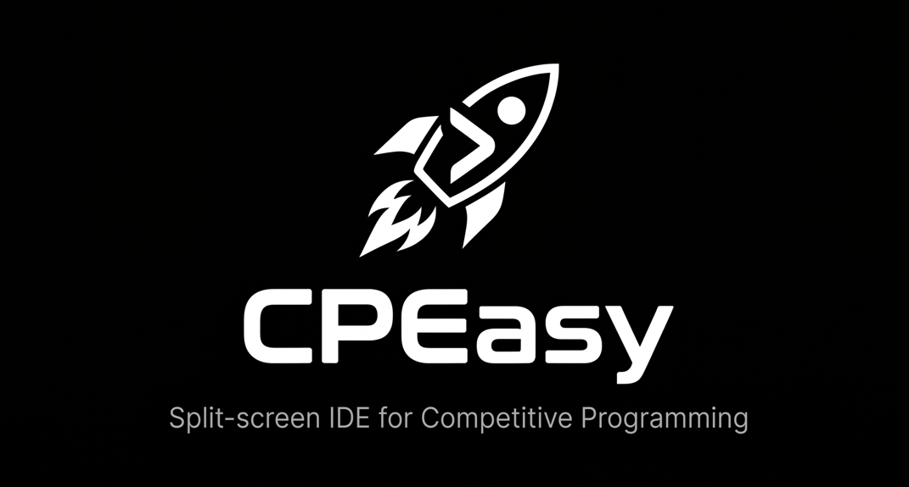

<div align="center">



# cpeasy

**A C++ coding workspace inside Codeforces.**

Read the problem. Write your solution. Test your code.  
Stay on the same page.

[Getting Started](#getting-started) · [Features](#features) · [Usage](#usage) · [Contributing](#contributing)

</div>

---

## Overview

cpeasy is a Chrome extension that adds a resizable C++ editor to Codeforces problem pages.

Keep the problem statement beside your code, run the provided samples, try custom input, and prepare your solution for submission—all from one workspace.

The project currently focuses on **C++ only**.

## Features

### Code editor

- C++ syntax highlighting and line numbers, powered by CodeMirror 5.
- Suggestions from the first letter, including C++ keywords, common standard-library names, and words from nearby code.
- Compiler-error underlines after running your code, with messages available on hover.
- Adjustable font size.
- A starter template with fast input/output and a separate `solve()` function.
- Reset to the default template, with recovery of the code saved before the reset.

### Testing and debugging

- Read sample inputs and expected outputs directly from the problem page.
- Run each complete sample input without splitting its internal test cases.
- Inspect input, output, expected output, and results in individual tabs.
- Enter custom input and run it separately.
- View compilation errors, runtime errors, and execution-service errors.
- Inspect execution time and memory usage when returned by the execution service.
- Highlight output differences.
- Show stale-result notices when code or custom input changes.

### Workspace

- Resizable problem/editor split and editor/results split.
- Expand the editor with focus mode.
- Dark and light themes.
- A compact toolbar and editor settings menu.
- Automatic draft saving per problem.
- A per-problem practice timer with pause, resume, and reset.
- Keyboard shortcuts for running code and opening suggestions.

### Submission handoff

The Submit button saves your draft and opens the Codeforces submission page. The extension then attempts to fill the problem, language, and source code.

**You review the form and make the final submission on Codeforces yourself.**

## Getting Started

### Requirements

- Google Chrome.
- An internet connection for remote code execution.
- A Codeforces account with access to the relevant submission page when submitting.

### Install locally

1. Clone the repository:

   ```bash
   git clone https://github.com/VaibhavDGP/CF-IDE-Extension.git
   ```

   Alternatively, download and extract the repository ZIP.

2. Open `chrome://extensions` in Chrome.
3. Enable **Developer mode**.
4. Click **Load unpacked**.
5. Select the repository folder containing `manifest.json`.
6. Open or refresh a Codeforces problem page.
7. Click **Open cpeasy IDE** beside the problem title.

No npm installation or build step is required.

### Update your local installation

After updating the source files:

1. Open `chrome://extensions`.
2. Click **Reload** on cpeasy.
3. Refresh your Codeforces tabs.

## Usage

### Write a solution

Open a Codeforces problem and launch cpeasy.

The default template includes a `solve()` function and runs one test case. If the problem's input starts with a test-case count, uncomment:

```cpp
cin >> t;
```

The template uses `<bits/stdc++.h>`, a GNU-specific convenience header.

### Run samples

Click **Run** or use the run keyboard shortcut.

The runner executes each complete sample input and compares its output with the sample's expected output. Runs are currently processed one at a time.

If the Custom tab contains nonempty input, the main Run action also executes that input.

### Run custom input

1. Open the **Custom** tab.
2. Enter your input.
3. Click **Run Custom**.

Run Custom executes only the custom input, including an empty input if that is what you want to test.

Custom runs show execution results and output; they do not check an expected answer.

### Review errors

After a run, supported compiler diagnostics referring to `main.cpp` are displayed as red underlines in the editor.

Hover over an underlined line to read its message. Editing the code clears the old underlines.

### Submit a solution

1. Sign in to Codeforces.
2. Click **Submit ↗** in cpeasy.
3. Review the populated Codeforces submission form.
4. Submit using Codeforces' own controls.

Access restrictions, contest participation requirements, or changes to the Codeforces form can affect this handoff.

## Keyboard Shortcuts

Use these while the code editor is focused:

| Shortcut | Action |
| --- | --- |
| `Ctrl + Enter` | Run samples and any nonempty custom input |
| `Cmd + Enter` | Run on macOS |
| `Ctrl + Space` | Request suggestions |
| `↑` / `↓` | Navigate the suggestion list |
| `Enter` | Accept the selected suggestion |
| `Esc` | Dismiss suggestions |

## How Execution Works

```text
Codeforces problem page
        │
        ▼
cpeasy editor and sample reader
        │
        ▼
Extension background service worker
        │
        ▼
Judge0 execution service
        │
        ▼
Output, diagnostics, and execution statistics
        │
        ▼
Sample comparison and results panel
```

The background worker sends the source code and input to the configured Judge0 endpoint, polls for completion, and returns the result to the editor.

The current endpoint is:

```text
https://ce.judge0.com
```

Availability, access restrictions, and rate limits depend on that external service.

## What the Results Mean

**“Sample passed” means the output matched that sample—not that the solution is accepted by Codeforces.**

The current comparison:

- Normalizes Windows line endings.
- Ignores leading and trailing whitespace around the complete output.
- Compares the remaining text exactly.

It does not reproduce Codeforces' special checkers, floating-point tolerances, or validation for problems with multiple correct outputs.

Interactive problems are not supported by this sample runner.

Execution time and memory measurements come from Judge0 and may differ from Codeforces.

## Editor Assistance: Current Scope

Autocomplete provides keyword and word suggestions. It is not a full C++ language server and does not understand types, resolve headers, or provide semantic IntelliSense.

Compiler-error underlines appear **after execution**, where supported diagnostics are available. They are not live error checking while you type.

## Storage and Data

- **Solution drafts:** saved locally using `chrome.storage.local`.
- **Custom input and some preferences:** stored in browser `localStorage`.
- **Practice timer:** stored in `sessionStorage` for the current tab and problem.
- **Submission handoff:** temporarily stored in `sessionStorage`.

Code execution sends your **source code and test input** to the configured Judge0 service.

CodeMirror and its addons are bundled with the extension.

Browser storage is not a backup service. Clearing browser data or removing the extension may remove saved information.

## Project Structure

```text
CF-IDE-Extension/
├── manifest.json
├── icon.png
├── README.md
├── src/
│   ├── background/
│   │   └── service-worker.js
│   ├── content/
│   │   ├── config.js
│   │   ├── cpp-editor.js
│   │   ├── ide.js
│   │   └── utils.js
│   ├── popup/
│   │   └── popup.html
│   └── styles/
│       ├── cpeasy.css
│       └── cpeasy-refresh.css
└── vendor/
    └── codemirror/
        ├── codemirror.min.js
        ├── codemirror.min.css
        ├── clike.min.js
        ├── material.min.css
        ├── show-hint.js
        └── show-hint.css
```

| File | Responsibility |
| --- | --- |
| `manifest.json` | Extension configuration, permissions, and resource loading |
| `src/background/service-worker.js` | Judge0 requests and submission-editor synchronization |
| `src/content/config.js` | C++ template and compiler/submission mappings |
| `src/content/cpp-editor.js` | Autocomplete and compiler-error markers |
| `src/content/ide.js` | Workspace, drafts, timer, testing, and submission handoff |
| `src/content/utils.js` | Shared helpers and submission-route handling |
| `src/styles/cpeasy.css` | Base styles |
| `src/styles/cpeasy-refresh.css` | Updated layout and appearance |
| `src/popup/popup.html` | Extension popup |

## Technology

- Chrome Extensions Manifest V3
- Vanilla JavaScript
- HTML and CSS
- CodeMirror 5
- Judge0
- Chrome Storage API and browser Web Storage

## Troubleshooting

### The editor button is missing

Make sure you are on an individual Codeforces problem page. Reload the extension, then refresh the page.

If it still does not appear, check the extension's Errors panel at `chrome://extensions`.

### Suggestions are missing or appear behind the editor

Confirm that the autocomplete addon is listed in `manifest.json`.

The stylesheet order should be:

```text
codemirror.min.css
material.min.css
show-hint.css
cpeasy.css
cpeasy-refresh.css
```

Refresh the Codeforces page after reloading the extension.

### Execution fails or times out

Check your connection and the displayed service error. The Judge0 endpoint may be unavailable, rate-limited, or denying access.

### Codeforces refuses access to Submit

Check that you are signed in and can open Codeforces' own Submit tab for that problem.

If the native tab works but the extension's Submit button does not, report the problem URL and the destination URL.

### The new template does not appear

Existing drafts are preserved. Open a problem without a saved draft, or use **Settings → Reset code** to replace the current code with the template.

## Contributing

Bug reports and focused pull requests are welcome.

For a bug report, include:

- The Codeforces problem URL.
- Steps to reproduce the issue.
- Expected and actual behavior.
- Browser version.
- Relevant console errors or screenshots.

For code changes:

1. Fork the repository.
2. Create a branch for your change.
3. Load your copy as an unpacked extension.
4. Test the affected behavior.
5. Open a pull request explaining the change and your checks.

For workspace changes, check both themes, panel resizing, sample/custom runs, and draft persistence.

## Acknowledgments

- [CodeMirror](https://codemirror.net/5/) — browser-based code editor.
- [Judge0](https://judge0.com/) — remote code execution.
- [Codeforces](https://codeforces.com/) — the programming platform this extension supports.

cpeasy is an independent project and is not affiliated with or endorsed by Codeforces.